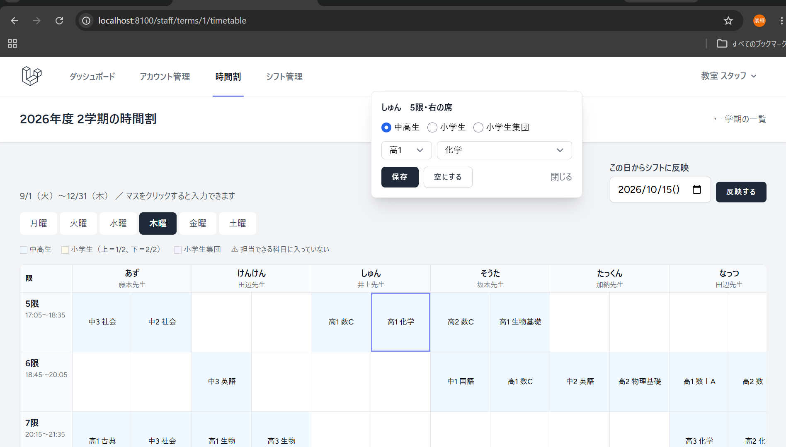
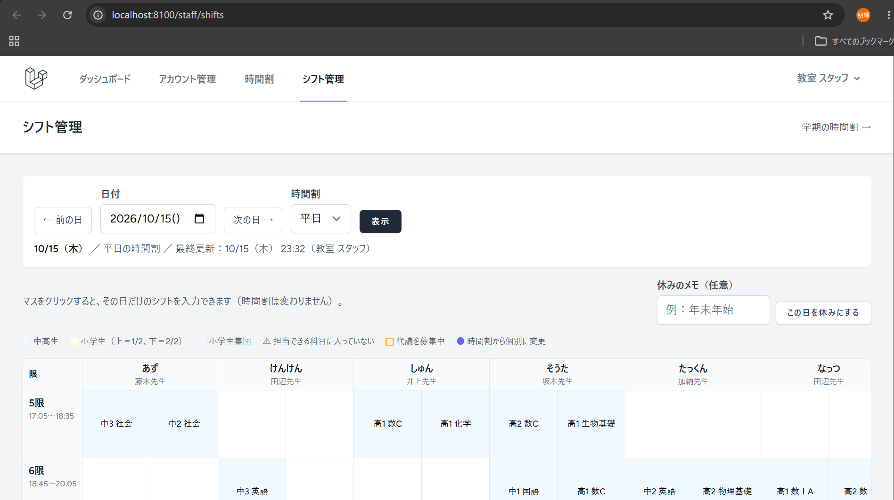
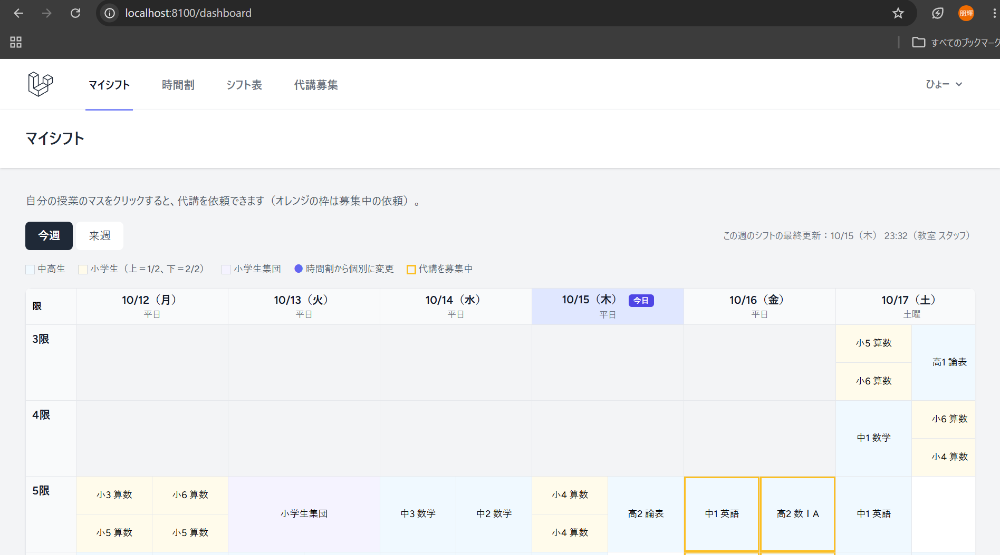
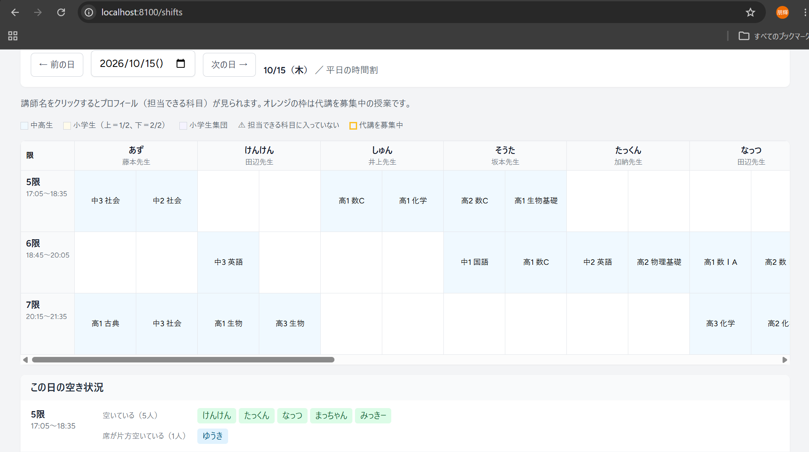
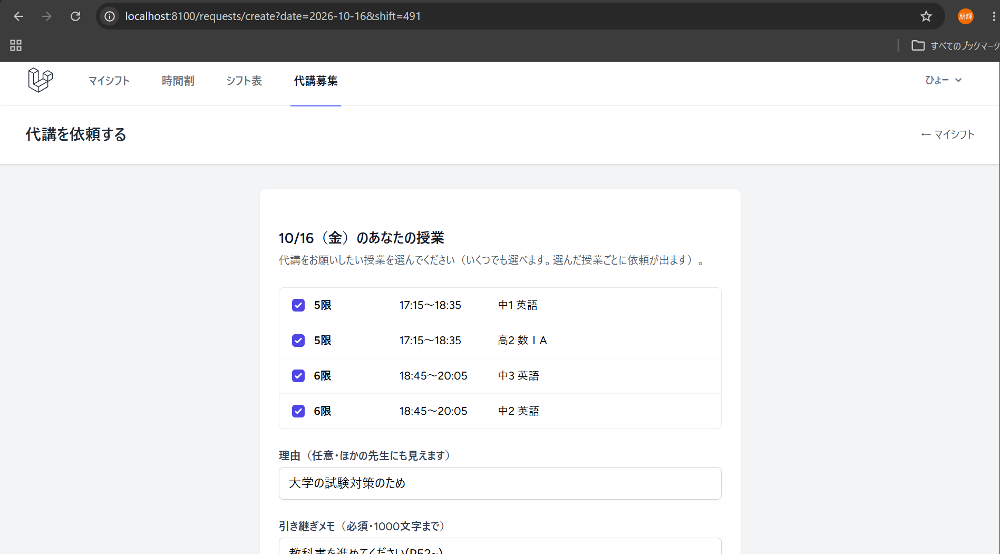
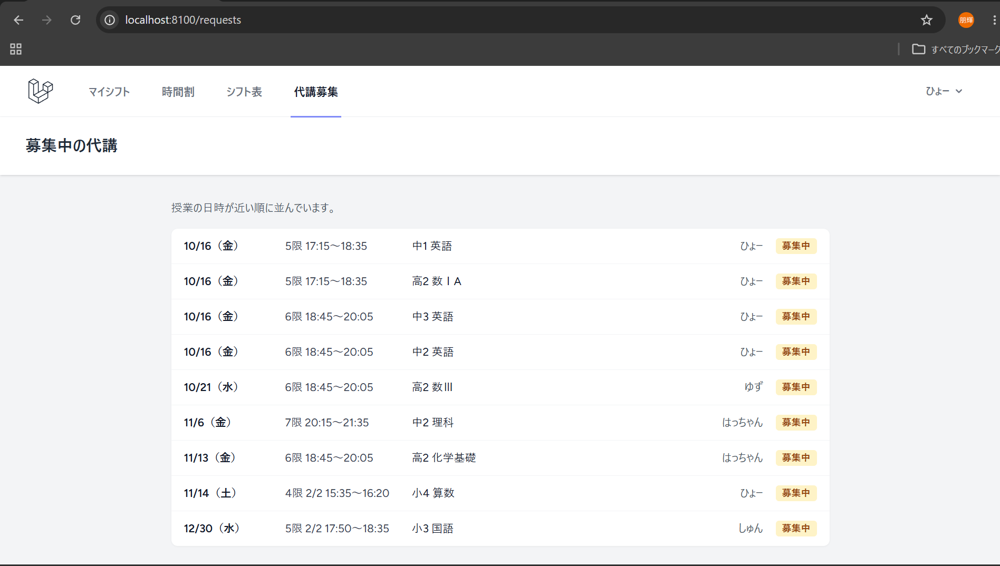
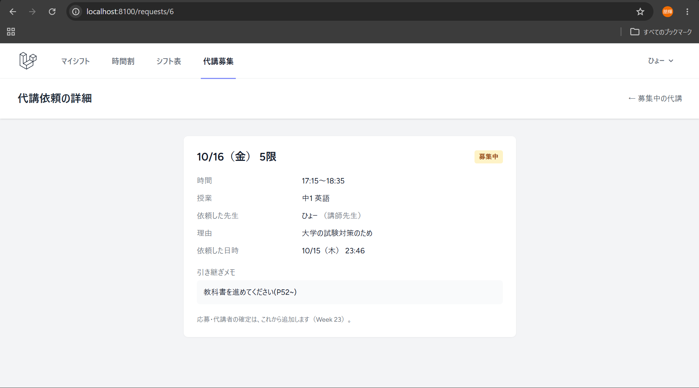
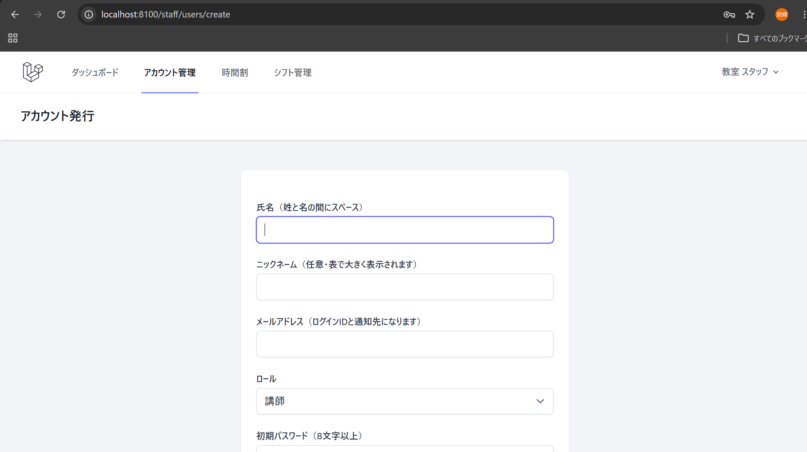
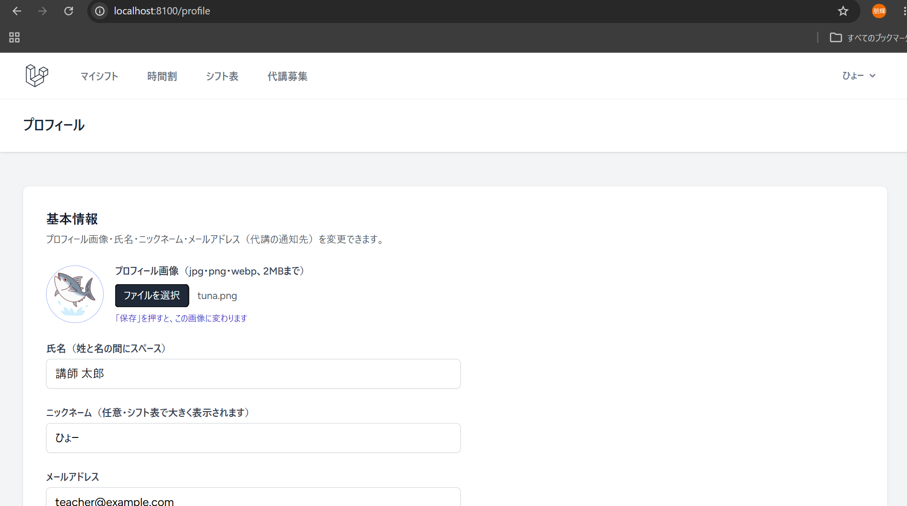

# DaikoLink（代講マッチング・シフト共有システム）


個別指導塾の講師が **全講師のシフトを見て、サイト上で代講の「依頼 → 応募 → 確定」までを講師どうしで完結できる** Webアプリです。
techmeets Week 22〜24 の総合プロジェクトとして開発しています。

## 解決したい課題

アルバイト先の個別指導塾では、予定のシフトが紙でしか共有されておらず、講師全体が把握しきれていません。授業に出られないときは、本人が直接の声かけや LINE で代講者を探し、見つからなければ教室スタッフが当日に電話をかけていますが、代講者が決まるまで数時間かかっています。

- 講師はほかの講師のシフトが分からず、誰に頼めばよいか判断できない
- 声かけ・LINE・電話は1人ずつなので時間がかかる
- やり取りが散らばり、依頼状況や履歴が残らない

## 主な機能（Week 22 時点）

| 機能 | 内容 |
|---|---|
| 認証・ロール | 講師／スタッフ。アカウントはスタッフが発行し、メール確認あり。退職者はログイン不可 |
| 学期の時間割 | 学期ごとに「曜日×限×講師×席（生徒2人分）」で学年と科目を登録し、シフトを自動作成 |
| シフト管理（スタッフ） | 日ごとのシフトの変更・休みの日・講習の時間割への切り替え。個別の変更は時間割を反映し直しても残る |
| マイシフト（講師） | 今週・来週の自分のシフトを1週間の表で表示 |
| シフト表（講師） | その日の全員のシフトと、限ごとの「空いている講師」「席が片方空いている講師」 |
| 代講依頼 | マイシフトから授業を選んで依頼（部分的な代講・複数まとめても可）、募集中の一覧と詳細 |
| プロフィール | プロフィール画像・ニックネーム・担当できる科目。講師名クリックで表示 |
| 科目管理（スタッフ） | 小学・中学・高校・その他（DOJO・キュレオ）の区分つき。追加・名前の変更・非表示 |

実際の運用（出勤簿システムの画面と紙のシフト表）に合わせて、次のように作っています。

- 時間割は「平日（5〜7限）・土曜（3〜7限）・講習（1〜7限）」の3パターン。祝日も曜日どおり
- 講師1人が生徒2人を同時に見るため、表は「縦＝限、横＝講師（2列）」で、1マス＝生徒1人
- 小学生は1コマを前半（1/2）・後半（2/2）に分けて別の生徒を見ることがあるため、マスを上下に分ける
- 同じ時刻に見る生徒が2人を超えないことを、登録・反映のたびにチェック

## 画面

| 時間割の入力（スタッフ） | シフト管理（スタッフ） |
|---|---|
|  |  |

| マイシフト（講師） | シフト表と空き状況（講師） |
|---|---|
|  |  |

| 代講依頼の作成 | 募集中の代講 | 代講依頼の詳細 |
|---|---|---|
|  |  |  |

| アカウント発行（スタッフ） | プロフィール |
|---|---|
|  |  |

## 技術スタック

PHP 8.3 / Laravel 12 / MySQL 8.0 / Blade + Tailwind CSS + Alpine.js / Docker（nginx・PHP-FPM・MySQL）/ GitHub Actions（Pint・PHPStan level 5・PHPUnit）

選定理由は [技術選定資料](docs/tech-stack.md) を参照。

## ローカルでの起動

```bash
git clone https://github.com/tomoki-omigawa-tech/daikolink.git
cd daikolink
cp .env.example .env
docker compose up -d --build
docker compose exec app composer install
docker compose exec app php artisan key:generate
docker compose exec app php artisan migrate --seed
docker compose exec app php artisan storage:link
npm install && npm run build
```

http://localhost:8100 を開き、架空のアカウントでログインできます（パスワードはすべて `password`）。

| ロール | メールアドレス |
|---|---|
| スタッフ | staff@example.com |
| 講師 | teacher@example.com |

## テスト

```bash
docker compose exec db mysql -uroot -proot -e "CREATE DATABASE IF NOT EXISTS testing; GRANT ALL ON testing.* TO 'daikolink'@'%';"
docker compose exec app php artisan test
docker compose exec app vendor/bin/phpstan analyse
```

Feature テスト・Unit テスト（109件）で、権限・入力チェック・同じ時刻の生徒数・時間割の反映（個別の変更を残す）・代講依頼の二重作成の防止などを確認しています。PR ごとに GitHub Actions で Lint と Test を実行しています。

## ドキュメント

| 分類 | ドキュメント |
|---|---|
| 要件定義 | [要件定義書](docs/requirements/requirements.md)（Week 22 で実際の運用に合わせて追記） |
| 設計 | [設計書の概要](docs/design/00_overview.md) ／ [画面設計書](docs/design/01_screen-design.md) ／ [DB設計書](docs/design/02_database-design.md) ／ [API仕様書](docs/design/03_api-specification.md) ／ [インフラ構成図](docs/design/05_infrastructure.md) |
| 技術選定 | [技術選定資料](docs/tech-stack.md) |
| 開発計画 | [工数見積もり](docs/design/04_estimation.md) ／ [プロダクトバックログ](docs/plan/01_user-stories.md) ／ [スプリント計画](docs/plan/02_sprint-plan.md) ／ [振り返り](docs/plan/04_retrospective.md) ／ [カンバン](docs/plan/03_kanban.md) ／ [KPI](docs/plan/05_kpi.md) ／ [見積書](docs/plan/06_estimate.md) |

画面設計（Figma）：[DaikoLink ワイヤーフレーム](https://www.figma.com/design/HdwrVosRCATDjHIMcPdPYE/DaikoLink_Week19)

## 開発スケジュール

| スプリント | 期間 | ゴール | 状況 |
|---|---|---|---|
| Sprint 1 | Week 22 | ログインして全講師のシフトを確認し、自分のコマから代講依頼を出せる | ✅ 完了 |
| Sprint 2 | Week 23 | 依頼 → 応募 → 確定 → シフト反映 → メール通知までが一通りつながる | |
| Sprint 3 | Week 24 | テスト（カバレッジ70%）と CI を整え、本番 URL で MVP が動く | |

## 作成者

小見川 朋輝
