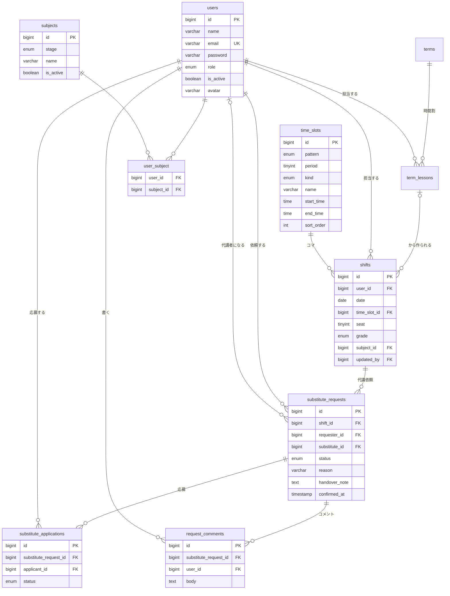

# DB設計書

## ER図

## テーブル一覧
| テーブル | 内容 | 優先度 |
|---|---|---|
| users | 講師・スタッフ（role で区別） | Must |
| terms / term_lessons | 学期と学期の時間割（シフトの元） | Must（Week 22で追加） |
| closed_days | 塾が休みの日 | Must（Week 22で追加） |
| time_slots | 授業枠の定義（平日・土曜・講習。Seederで固定データ） | Must |
| shifts | 日付 × コマ × 担当講師 | Must |
| substitute_requests | 代講依頼 | Must |
| substitute_applications | 応募 | Must |
| request_comments | 依頼ごとのコメント | Should |
| subjects / user_subject | 科目（区分つき）と講師の担当科目 | Must（Week 22で実装） |

※ Laravel 標準の sessions、password_reset_tokens、jobs、failed_jobs、cache も使用する。
※ 生徒の個人情報を保存するテーブルは作らない。

## テーブル定義

### users（講師・スタッフ）
| カラム名 | 型 | NULL | デフォルト | 説明 |
|---|---|---|---|---|
| id | BIGINT UNSIGNED | NO | AUTO_INCREMENT | ユーザーID（PK） |
| name | VARCHAR(50) | NO | - | 氏名 |
| email | VARCHAR(100) | NO | - | メールアドレス（通知先） |
| email_verified_at | TIMESTAMP | YES | NULL | メール確認日時 |
| password | VARCHAR(255) | NO | - | パスワード（ハッシュ） |
| role | ENUM('teacher','staff') | NO | 'teacher' | ロール |
| is_active | BOOLEAN | NO | true | 在籍中か（退職者は false にしてログイン不可・通知対象外） |
| avatar | VARCHAR(255) | YES | NULL | プロフィール画像のパス（Week 22で追加） |
| remember_token | VARCHAR(100) | YES | NULL | ログイン保持 |
| created_at / updated_at | TIMESTAMP | YES | NULL | 作成・更新日時 |

- インデックス：PRIMARY KEY (id)、UNIQUE (email)、INDEX (role, is_active)

### time_slots（授業枠）
| カラム名 | 型 | NULL | デフォルト | 説明 |
|---|---|---|---|---|
| id | BIGINT UNSIGNED | NO | AUTO_INCREMENT | 授業枠ID（PK） |
| pattern | ENUM('weekday','saturday','intensive') | NO | - | 時間割パターン（平日・土曜・講習） |
| period | TINYINT UNSIGNED | NO | - | 限（1〜7） |
| kind | ENUM('secondary','elementary_first','elementary_second','elementary_group') | NO | - | 種類（中高生・小学生1/2・小学生2/2・小学生集団） |
| name | VARCHAR(30) | NO | - | 表示名（出勤簿と同じ表記。例：5限、5限 1/2、5限（小学生集団）） |
| start_time | TIME | NO | - | 開始時刻 |
| end_time | TIME | NO | - | 終了時刻 |
| sort_order | SMALLINT UNSIGNED | NO | 0 | 表示順（限×10＋種類の順） |
| created_at / updated_at | TIMESTAMP | YES | NULL | 作成・更新日時 |

- インデックス：PRIMARY KEY (id)、UNIQUE (pattern, period, kind)
- データは Seeder で投入（管理画面は Could）
- 平日：5〜7限（5限は中高生・1/2・2/2・集団）。土曜：3〜7限（3限は集団あり、3〜5限に1/2・2/2）。講習：1〜7限（中高生のみ、土日も実施）
- 日付のパターンは曜日から自動で決まり（月〜金＝平日、祝日も曜日どおり。土＝土曜。日＝休み）、講習期間はスタッフが講習に切り替える。1日のシフトはすべて同じパターンの授業枠を使う

### shifts（シフト）
| カラム名 | 型 | NULL | デフォルト | 説明 |
|---|---|---|---|---|
| id | BIGINT UNSIGNED | NO | AUTO_INCREMENT | シフトID（PK） |
| user_id | BIGINT UNSIGNED | NO | - | 担当講師ID（FK）。代講確定時に代講者へ更新 |
| date | DATE | NO | - | 授業日 |
| time_slot_id | BIGINT UNSIGNED | NO | - | 授業枠ID（FK） |
| seat | TINYINT UNSIGNED | NO | 1 | 席（1＝左、2＝右）。講師1人が生徒2人を見るため |
| grade | ENUM('e3'〜'e6','j1'〜'j3','h1'〜'h3') | YES | NULL | 生徒の学年（小3〜高3）。小学生集団は NULL |
| subject_id | BIGINT UNSIGNED | YES | NULL | 科目ID（FK）。学年の区分に合う科目 |
| term_lesson_id | BIGINT UNSIGNED | YES | NULL | 時間割のどの授業から作られたか（FK、ON DELETE SET NULL） |
| is_manual | BOOLEAN | NO | false | 日ごとのシフト管理や代講確定で個別に変更したシフト（時間割の反映で上書きしない） |
| updated_by | BIGINT UNSIGNED | YES | NULL | 最後に更新した人（FK）。スタッフの編集・代講確定で更新 |
| created_at / updated_at | TIMESTAMP | YES | NULL | 作成・更新日時（updated_at を最終更新日時として講師に表示） |

- インデックス：PRIMARY KEY (id)、UNIQUE (user_id, date, time_slot_id, seat)、INDEX (date, time_slot_id)
- 外部キー：user_id → users(id) ON DELETE RESTRICT、time_slot_id → time_slots(id) ON DELETE RESTRICT、subject_id → subjects(id) ON DELETE SET NULL、updated_by → users(id) ON DELETE SET NULL
- 1行＝生徒1人の授業（講師×日付×授業枠×席）。例：5限で左の席に中2数学、右の席の前半に小5算数・後半に小4国語なら「5限 席1 中2 数学」「5限 1/2 席2 小5 算数」「5限 2/2 席2 小4 国語」の3行
- 授業枠の種類と学年を一致させる（小学生の学年は 1/2・2/2、中高生の学年は中高生の枠）。小学生集団は1行で満席扱い
- 講師1人が同時に見られる生徒は2人まで（ある時刻に授業中の行の数。集団は2）。登録・応募・確定時にアプリで確認する
- 代講依頼は生徒1人の授業（1行）ごとに出すため、「1人ずつ募集」も特別な仕組みなしで扱える

### terms（学期）
| カラム名 | 型 | NULL | デフォルト | 説明 |
|---|---|---|---|---|
| id | BIGINT UNSIGNED | NO | AUTO_INCREMENT | 学期ID（PK） |
| fiscal_year | SMALLINT UNSIGNED | NO | - | 年度 |
| term_no | TINYINT UNSIGNED | NO | - | 何学期（1〜3） |
| start_date / end_date | DATE | NO | - | 開始日・終了日（スタッフが入力。学期どうしは重ならない） |
| created_at / updated_at | TIMESTAMP | YES | NULL | 作成・更新日時 |

- インデックス：PRIMARY KEY (id)、UNIQUE (fiscal_year, term_no)

### term_lessons（学期の時間割の授業）
| カラム名 | 型 | NULL | デフォルト | 説明 |
|---|---|---|---|---|
| id | BIGINT UNSIGNED | NO | AUTO_INCREMENT | 授業ID（PK） |
| term_id | BIGINT UNSIGNED | NO | - | 学期ID（FK） |
| weekday | TINYINT UNSIGNED | NO | - | 曜日（1＝月〜6＝土） |
| time_slot_id | BIGINT UNSIGNED | NO | - | 授業枠ID（FK）。月〜金は平日、土は土曜の時間割の枠 |
| seat | TINYINT UNSIGNED | NO | 1 | 席（1＝左、2＝右） |
| user_id | BIGINT UNSIGNED | NO | - | 担当講師ID（FK） |
| grade | ENUM（shifts と同じ） | YES | NULL | 生徒の学年 |
| subject_id | BIGINT UNSIGNED | YES | NULL | 科目ID（FK） |
| created_at / updated_at | TIMESTAMP | YES | NULL | 作成・更新日時 |

- インデックス：PRIMARY KEY (id)、UNIQUE (term_id, weekday, user_id, time_slot_id, seat)、INDEX (term_id, weekday)
- 外部キー：term_id → terms(id) ON DELETE CASCADE、time_slot_id・user_id は RESTRICT、subject_id は SET NULL
- 「○月○日から適用」で、その日から学期末までのシフトを作り直す（日曜・休みの日・講習の日は対象外）。個別に変更したシフト（shifts.is_manual）と代講依頼があるシフトは残し、それとぶつかる授業は作らない

### closed_days（休みの日）
| カラム名 | 型 | NULL | デフォルト | 説明 |
|---|---|---|---|---|
| id | BIGINT UNSIGNED | NO | AUTO_INCREMENT | ID（PK） |
| date | DATE | NO | - | 休みの日（UNIQUE） |
| note | VARCHAR(50) | YES | NULL | メモ（例：年末年始） |
| created_at / updated_at | TIMESTAMP | YES | NULL | 作成・更新日時 |

- 休みの日はシフトを作らない。日曜は登録しなくても休み（講習のときだけ日ごとのシフト管理で入力）

### substitute_requests（代講依頼）
| カラム名 | 型 | NULL | デフォルト | 説明 |
|---|---|---|---|---|
| id | BIGINT UNSIGNED | NO | AUTO_INCREMENT | 依頼ID（PK） |
| shift_id | BIGINT UNSIGNED | NO | - | 対象シフトID（FK） |
| requester_id | BIGINT UNSIGNED | NO | - | 依頼者ID（FK） |
| substitute_id | BIGINT UNSIGNED | YES | NULL | 確定した代講者ID（FK） |
| status | ENUM('open','applied','confirmed','cancelled','expired') | NO | 'open' | 状態 |
| reason | VARCHAR(255) | YES | NULL | 理由 |
| handover_note | TEXT | NO | - | 引き継ぎメモ |
| confirmed_at | TIMESTAMP | YES | NULL | 確定日時（確定までの時間の計測に使用） |
| staff_notified_at | TIMESTAMP | YES | NULL | 正午の未確定通知を送った日時（Should） |
| created_at / updated_at | TIMESTAMP | YES | NULL | 作成・更新日時 |

- インデックス：PRIMARY KEY (id)、INDEX (shift_id, status)、INDEX (status, created_at)、INDEX (requester_id)
- 外部キー：shift_id → shifts(id) ON DELETE CASCADE、requester_id → users(id) ON DELETE RESTRICT、substitute_id → users(id) ON DELETE SET NULL
- 状態の意味：open＝募集中、applied＝応募あり、confirmed＝確定、cancelled＝取消、expired＝不成立

### substitute_applications（応募）
| カラム名 | 型 | NULL | デフォルト | 説明 |
|---|---|---|---|---|
| id | BIGINT UNSIGNED | NO | AUTO_INCREMENT | 応募ID（PK） |
| substitute_request_id | BIGINT UNSIGNED | NO | - | 依頼ID（FK） |
| applicant_id | BIGINT UNSIGNED | NO | - | 応募者ID（FK） |
| status | ENUM('pending','accepted','rejected','withdrawn') | NO | 'pending' | 応募中・採用・見送り・取り消し |
| created_at / updated_at | TIMESTAMP | YES | NULL | 作成・更新日時 |

- インデックス：PRIMARY KEY (id)、UNIQUE (substitute_request_id, applicant_id)、INDEX (applicant_id)
- 外部キー：substitute_request_id → substitute_requests(id) ON DELETE CASCADE、applicant_id → users(id) ON DELETE CASCADE
- UNIQUE により同じ依頼への重複応募を防ぐ（取り消し後の再応募は status を pending に戻す）

### request_comments（コメント・Should）
| カラム名 | 型 | NULL | デフォルト | 説明 |
|---|---|---|---|---|
| id | BIGINT UNSIGNED | NO | AUTO_INCREMENT | コメントID（PK） |
| substitute_request_id | BIGINT UNSIGNED | NO | - | 依頼ID（FK） |
| user_id | BIGINT UNSIGNED | NO | - | 投稿者ID（FK） |
| body | TEXT | NO | - | 本文（1000文字以内） |
| created_at / updated_at | TIMESTAMP | YES | NULL | 作成・更新日時 |

- インデックス：PRIMARY KEY (id)、INDEX (substitute_request_id, created_at)
- 外部キー：substitute_request_id → substitute_requests(id) ON DELETE CASCADE、user_id → users(id) ON DELETE CASCADE

### subjects / user_subject（担当科目）
| テーブル | カラム | 説明 |
|---|---|---|
| subjects | id (PK)、stage ENUM('elementary','junior','senior','other')、name VARCHAR(30)、is_active BOOLEAN、sort_order、timestamps、UNIQUE (stage, name) | 科目マスタ。区分（小学・中学・高校・その他）＋名前で1科目（小学の国語と中学の国語は別）。スタッフが追加でき、削除の代わりに is_active で非表示にする |
| user_subject | user_id (FK)、subject_id (FK)、PRIMARY KEY (user_id, subject_id) | 講師が担当できる科目（講師本人とスタッフがチェックで設定） |

- 初期データ：小学（国語・算数・英語）、中学（国語・数学・英語・理科・社会）、高校（古典・論表・数ⅠA・数ⅡB・数Ⅲ・数C・物理基礎・化学基礎・生物基礎・物理・化学・生物）、その他（DOJO・キュレオ）
- 学年と選べる科目：小学生は小学、中学生は中学とその他、高校生は高校とその他

## データ整合性の設計
| ルール | 実現方法 |
|---|---|
| 同じ講師の同時刻の二重シフトを防ぐ | shifts の UNIQUE (user_id, date, time_slot_id) |
| 同じ依頼を二重に確定しない | 確定処理をトランザクション内で行い、依頼行を `lockForUpdate()` で取得して status を再確認 |
| 同じ授業（シフト）に未確定の依頼を重複して作らない | 作成時にトランザクション内で shift 行をロックし、status が open / applied の依頼がないか確認 |
| 応募者の同じ時刻の生徒が2人を超えない | 応募時と確定時の両方で、応募者のその時刻に授業中のシフトの数（集団は2）を数えて確認 |
| 確定時のシフト更新 | 同じトランザクション内で、shifts.user_id を代講者に、seat を代講者の空いている席に更新し、updated_by を記録。他の応募を rejected に変更 |
| 授業開始後の不成立 | スケジューラで5分ごとに、開始時刻を過ぎた open / applied の依頼を expired に更新 |

## 全体シフト表のN+1対策
日付で shifts を取得する際に `with(['user', 'timeSlot'])` で一括取得し、空いている講師は「在籍中の講師一覧 − そのコマのシフト担当者」をアプリ側で計算する（クエリ数は日付あたり固定）。
